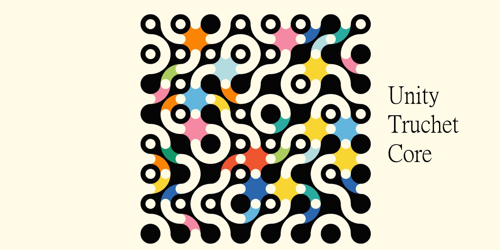

# Truchet Core


------------------------------------------------------------------------



Procedural GPU-driven tile system for Unity focused on scalability,
performance, and clean architecture.

------------------------------------------------------------------------

## 🎬 Preview

> *(Add GIF or screenshot here)*\
> Example:

    

------------------------------------------------------------------------

## 🚀 Features

-   ⚡ GPU instanced rendering (100k+ tiles)
-   🌳 QuadTree hierarchical layouts
-   🎨 Multi-tileset support
-   🧩 Texture2DArray batching
-   🛠 Procedural tile generation (Tile Cooking)
-   🧱 Modular architecture (replace any layer)

------------------------------------------------------------------------

## 🧠 Architecture

    Layout → Composition → Rendering

  Layer         Responsibility
  ------------- ------------------------------------
  Layout        Spatial structure & tile placement
  Composition   Convert layout → renderable data
  Rendering     GPU drawing & execution

------------------------------------------------------------------------

## 📥 Installation (UPM / Git URL)

In Unity: **Window → Package Manager → + → Install package from git URL…**

```
https://github.com/cholushkin/truchet-unity.git
```

### Dependencies — install first, in this order

This package does **not** declare the following as versioned `package.json`
dependencies (they are not available on a scoped registry), so install them
manually, in order, before installing Truchet Tiles:

1. **GameLib** (`com.qcat.gamelib`, used for `GameLib.Random` / `GameLib.Alg`):
   `https://github.com/cholushkin/gamelib.git`
2. **NaughtyAttributes** (inspector attributes, cholushkin fork/UPM branch):
   `https://github.com/cholushkin/NaughtyAttributes.git#upm`

Unity Registry dependency (resolved automatically): `com.unity.inputsystem`.

------------------------------------------------------------------------

## 📦 Documentation

### Core

-   [Core README](./Documentation/readme.md)

### Systems

-   [QuadTree](./Documentation/quadtree.md)
-   [Rendering
    Architecture](./Documentation/rendering_architecture.md)
-   [Composition
    Layer](./Documentation/composition_layer.md)
-   [Texture Array
    System](./Documentation/texture_array_system.md)
-   [TilePipeline
    Runtime](./Documentation/tilemap_runtime.md)
-   [Tile Cooking
    Pipeline](./Documentation/tile_cooking_pipeline.md)

------------------------------------------------------------------------

## ⚡ Quick Start

1.  Open Unity project\
2.  Add **TilePipeline** to a GameObject\
3.  Assign:
    -   Material
    -   TileSets (via modifiers)
4.  Press Play 🚀

------------------------------------------------------------------------

## 🏗 Key Concepts

### Layout

Defines where tiles exist.

### Modifiers

Populate layout with tile data.

### Composition

Builds renderable representation.

### Rendering

Draws everything using GPU instancing.

------------------------------------------------------------------------

## 📌 Entry Point

Start here:

👉 `TilePipeline`

------------------------------------------------------------------------

## 🧩 Design Goals

-   Clean separation of concerns\
-   High performance (GPU-first)\
-   Fully replaceable systems\
-   Deterministic behavior

------------------------------------------------------------------------

## 📜 License

MIT — see [LICENSE](./LICENSE).

------------------------------------------------------------------------

## 🗂 Repository layout notes

The repository root **is** the installable UPM package (`Runtime/`, `Editor/`,
`Samples~/`, `Documentation/`, `package.json`) — no nested sandbox project,
vendored libraries, or git submodules. `TileGeneratorScripts~/` holds the
Python tooling used to author the tile texture sets under `Textures/Tiles/`;
it is hidden from Unity's importer (`~` suffix) but kept in the repo for
reference.

------------------------------------------------------------------------

## ⭐ Notes

This project is designed as a **foundation for procedural worlds**, not
just a tile renderer.

You can extend it with: - Custom layouts - New composition strategies -
Alternative rendering backends
